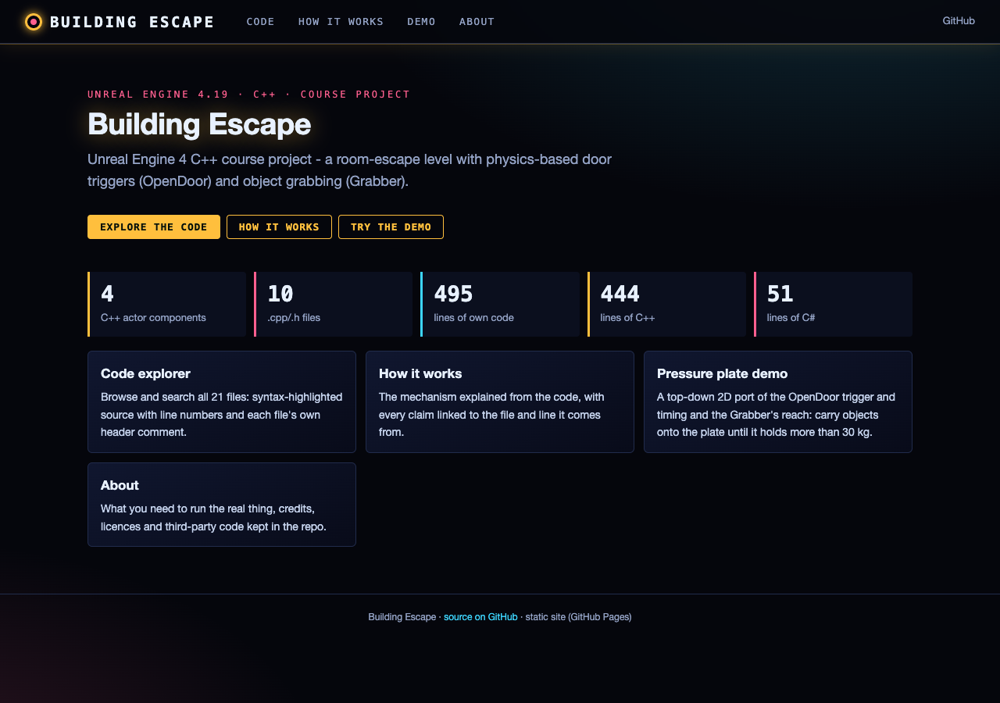
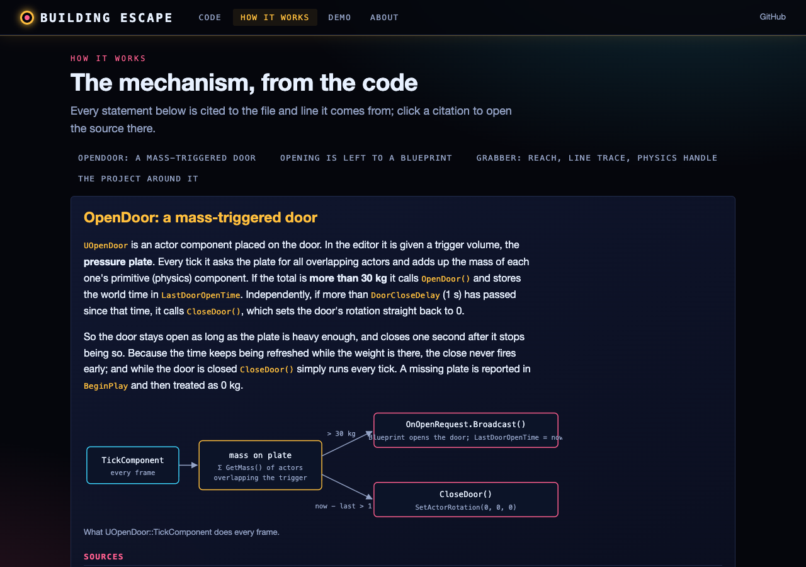
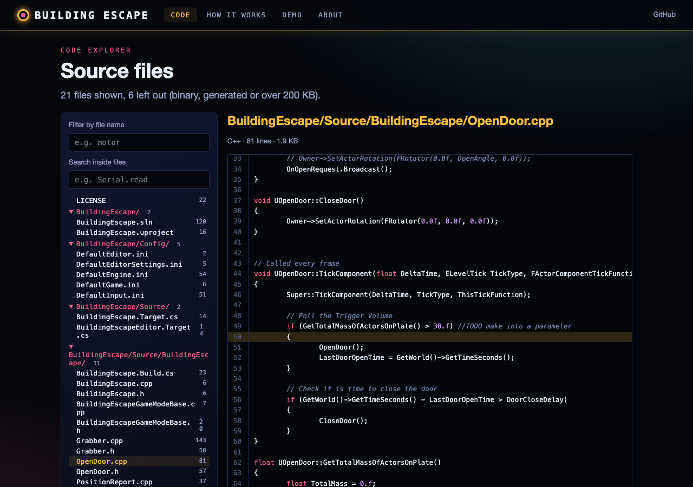
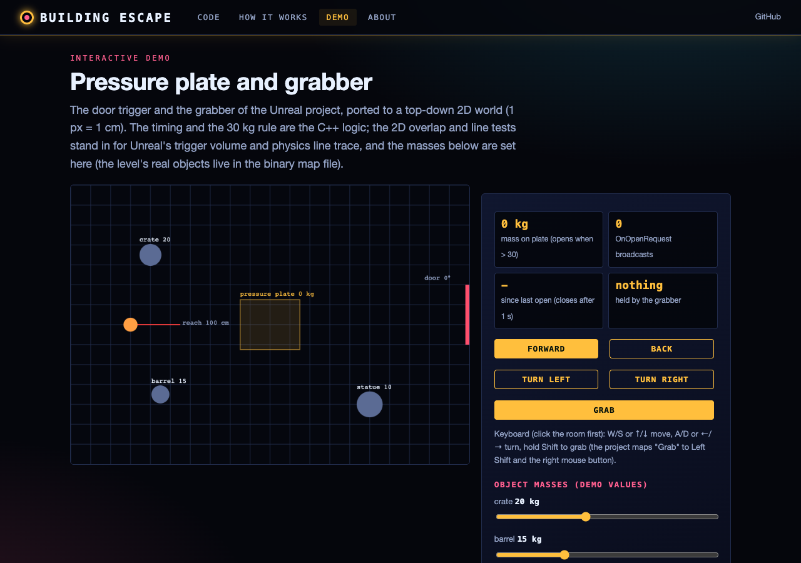

# Building Escape

Unreal Engine 4 C++ course project - a room-escape level with physics-based door triggers (`OpenDoor`) and object
grabbing (`Grabber`). Engine 4.19; open `BuildingEscape/BuildingEscape.uproject`.

- `BuildingEscape/Source/BuildingEscape/OpenDoor.*` - every tick, sums the mass of actors on a pressure-plate trigger
  volume; above 30 kg it broadcasts `OnOpenRequest` (the door Blueprint opens the door) and the door is set back to
  0° one second after the plate stops being heavy enough.
- `Grabber.*` - line trace of 100 cm from the player's view; the Grab action (Left Shift / right mouse button) picks up
  the first physics body with a physics handle, which then follows the end of the reach line.
- `PositionReport.*` - logs the owner's position at start.

## Web interface

A showcase site: code explorer, "How it works" with every statement linked to the file and line it comes from, and a
**pressure plate demo**: a top-down 2D JavaScript port of the OpenDoor trigger/timing and the Grabber's reach, with node
tests hand-traced from the C++ (`web/static/escape_engine.test.mjs`). The door's opening animation lives in a binary
Blueprint, so the demo shows it as a turn to `OpenAngle` (90°).

`pip install -r requirements-web.txt && python run_web.py` (http://127.0.0.1:8262). `python scripts/build_static.py`
builds the GitHub Pages copy (`.github/workflows/pages.yml`, on push to `master`). Tests: `python -m pytest -q tests`
and `node web/static/escape_engine.test.mjs`.

| Home | How it works | Source viewer | Pressure plate demo |
|---|---|---|---|
|  |  |  |  |

## Licence

MIT (see `LICENSE`).
